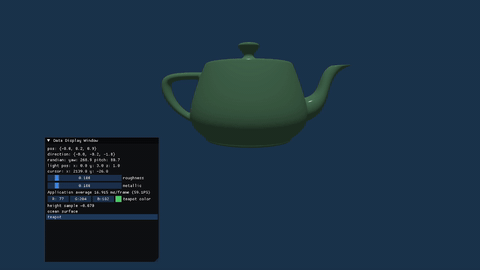
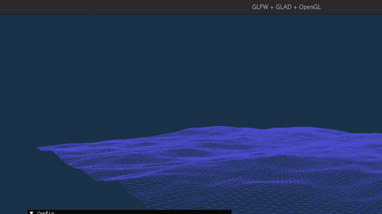

### 描述
该项目主要记录了一些个人实现的渲染模拟效果, 主要是学习opengl以及网络上一些文章.
- 海洋表面模拟
- PBR的光线
### 依赖
该项目依赖主要由conan center提供, 具体依赖记录在conanfile.txt文件中, imgui还是使用cmake的fetch功能获取的.
- glfw: 窗口与输入
- glad: 处理opengl的函数指针
- opengl: 渲染api
- glm: 数学库
- assimp: 导入模型
- imgui: 用于实时渲染的ui
### 效果
- PBR(physically based rendering): 模型使用了一个[茶壶](https://j5boom.itch.io/utah-teapot-obj), 或许你需要自己下载一下模型

  

- 海面波浪模拟: 使用的固定位置的网格, 主要是参考了[经典文章](https://jtessen.people.clemson.edu/reports/papers_files/coursenotes2004.pdf), 原理主要是傅里叶变换作为波函数叠加模拟海浪, 伯努利方程提供了物理物理性质.

  

### build
该项目使用的是llvm的工具链, 也就是clang编译器, 本地是linux和x86_64, 但是所使用库和工具基本都是跨平台的, 或许需要修改CMakeLists.txt. 下面主要是用[cmake](https://cmake.org/download/)和[conan](https://conan.io/downloads), 并且茶壶模型并没有一块上传.
- `conan profile detect`: 初始化conan的本地配置
- `conan install . -s build_type=Release --build=missing`: 让conan下载依赖包
- `cmake --preset conan-release`: config项目
- `cmake --build --preset conan-release`: 构建项目
- `./build/Release/a.out`: 运行